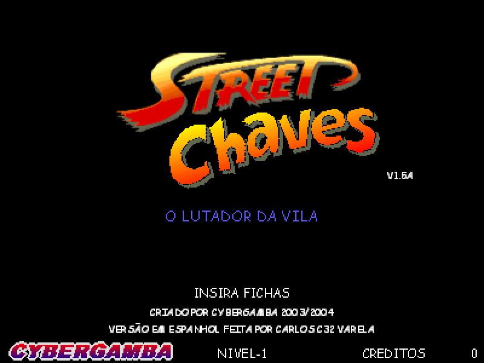
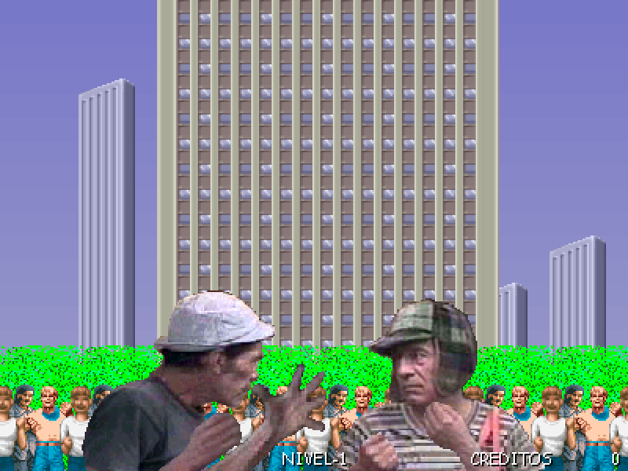
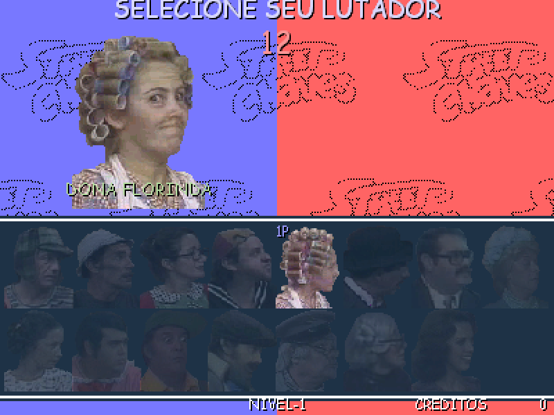
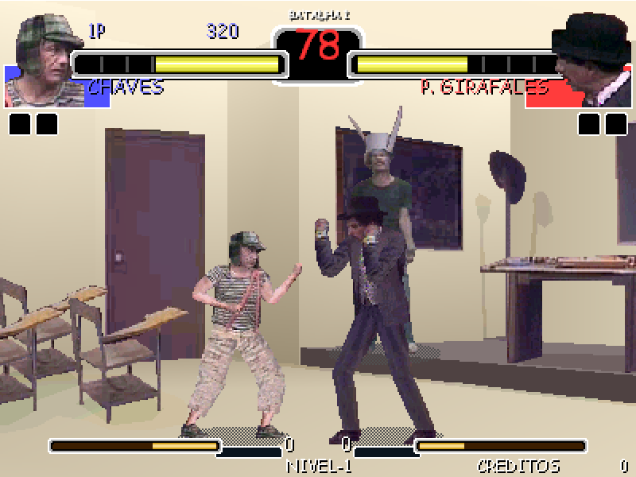

# OpenStreetChaves

Repositório dedicado para engenharia reversa e melhoria do antigo jogo brasileiro chamado Street Chaves.

O jogo original (Delphi 5 + DelphiX, `Chaves.exe`). Este projeto o reconstrói em
Lazarus/Free Pascal, mantendo a fidelidade ao original, e o migra para **SDL2** para ficar portável.

# Screenshots

| | |
|:---:|:---:|
|  |  |
| Tela de abertura | Abertura animada |
|  |  |
| Seleção de lutador | Luta |

## Estado desta versão (build atual)

O jogo roda **100% em SDL2**: janela, desenho, som e entrada. O programa principal não usa mais a LCL
nem formulários.

| Parte | Como é feito agora |
|-------|--------------------|
| Janela e vídeo | SDL2: a lógica do jogo usa coordenadas 400x300, mas o desenho é feito em software num buffer 3x maior (1200x900, ARGB; `EscalaTela` em `ChavesConst.pas`) e o SDL o apresenta (escala com barras pretas; F11 / Alt+Enter = tela cheia) |
| Gráficos | `ChavesGfx.pas`: superfícies, imagens e listas de imagens próprias (cópia normal, esticada, alfa, rotação), BMP lido sem bibliotecas e versões em alta resolução em PNG com alfa (pasta `HD/`, lidas com o `fcl-image` do Free Pascal) |
| Texto | Atlas de glifos pré-renderizados, sem depender de fonte do sistema em tempo de execução: `Fontes/ComicNeue-3x.atlas` (Comic Neue, licença OFL, na resolução 3x) e, se ele faltar ou com `EscalaTela = 1`, `Fontes/ComicSansMS.atlas` |
| Som | `ChavesSom.pas`: mixer próprio sobre o áudio do SDL (sem MCI, sem SDL2_mixer) |
| Entrada | Teclado por código físico do SDL (`SDL_SCANCODE_*`) e controles (gamepads e joysticks genéricos) para os jogadores 1 e 2 |
| Lógica do jogo | `TJogo` (`ChavesJogo.pas`), dividida em um arquivo `.inc` por estado do jogo (`source/game/Estado*.inc`) |

O que ainda falta para ser "SDL puro" em todas as plataformas está em [`source/MIGRACAO_SDL.md`](source/MIGRACAO_SDL.md).

# Requisitos para construir o jogo

1. **Lazarus 4.8** oficial (https://www.lazarus-ide.org/), com Free Pascal 3.2.2.
2. **SDL2.dll** (64 bits, versão **2.28 ou mais nova**) na **raiz do projeto**, ao lado do `StreetChaves.exe`.
   Baixe em https://github.com/libsdl-org/SDL/releases (arquivo `SDL2-2.28.x-win32-x64.zip`).
   O Git ignora `*.dll`, então cada pessoa que clonar o repositório precisa colocar a DLL.
   Sem a DLL o programa nem abre.
3. **Atlas de fonte** `Fontes/ComicNeue-3x.atlas` (já deve estar na pasta `Fontes/` do repositório).
   Se o arquivo não existir, o jogo usa `Fontes/ComicSansMS.atlas` ampliado; sem nenhum dos dois, avisa ao abrir.
   Para gerar os atlas, abra `source/tools/GeraFonte/GeraFonte.lpi`, construa e execute:
   * `GeraFonte.exe --hd` gera o `ComicNeue-3x.atlas` com a Comic Neue Bold de `Fontes/ComicNeue/` (licença OFL,
     `Fontes/ComicNeue/OFL.txt`; não precisa instalar). `--hd regular` usa o peso normal, mais fino. A altura das letras em cada tamanho é escolhida para que
     os textos tenham a mesma largura que na Comic Sans MS (se ela estiver instalada), e a linha de base é a dela.
   * `GeraFonte.exe` (sem parâmetro) gera o `ComicSansMS.atlas` (precisa da *Comic Sans MS* instalada no Windows).

   Ele confere o resultado contra todos os textos do jogo (log em `GeraFonte.log`).
   Atenção: a Comic Sans MS é uma fonte da Microsoft; decida se o `ComicSansMS.atlas` pode ser distribuído.
4. **Pasta `Dados/`** na raiz (já vem no repositório): `Jogo.ini` (valores do jogo e padrões), `Recursos.ini`
   (lista de imagens e sons) e `Textos/` (textos em português e espanhol). Sem o `Recursos.ini` o jogo avisa ao abrir e fecha.
5. Abra `source/StreetChaves.lpi` e use o menu Executar -> Construir (Ctrl+F9).

Pronto! O executável `StreetChaves.exe` aparece na raiz do projeto (ao lado das pastas `Cenarios`, `Lutadores`,
`Sons`, etc.) e é só abrir.

O programa `StreetChaves.exe --demo` abre um quadro de teste da infraestrutura SDL (útil para diagnosticar vídeo e entrada).

`StreetChaves.exe --gravar <pasta> [passos] [intervalo]` roda a lógica sem esperar o relógio, com semente fixa e teclas
roteirizadas, e grava um quadro BMP a cada `intervalo` passos (padrão: 3000 passos, 1 quadro a cada 50), mais o estado
da lógica (lutadores e efeitos) em `logica.txt`. Serve para conferir que uma mudança no desenho não alterou a lógica:
duas versões com a mesma lógica gravam o mesmo `logica.txt` (e, se o desenho também for igual, os mesmos quadros).

`--sem-hd` (em qualquer posição; com `--gravar`, por último) ignora as imagens em alta resolução da pasta `HD/`.

# Gráficos em alta resolução (pasta `HD/`)

O jogo desenha em 3x (1200x900). Para cada imagem `Pasta/Nome.bmp` ele procura antes `HD/Pasta/Nome.png`: um PNG com
canal alfa e **exatamente 3 vezes** o tamanho do BMP (folhas de lutadores com o mesmo layout, ampliado). Se não houver,
usa o BMP ampliado. Um PNG com tamanho errado é ignorado e anotado em `HD.log`. O título da janela mostra quantas
imagens HD foram carregadas.

A pasta `HD/` é gerada pela ferramenta `source/tools/GeraHD` (abra `GeraHD.lpi`, construa; o `GeraHD.exe` aparece na raiz):

* `GeraHD.exe` amplia todas as imagens (Lutadores, Efeitos, Animacoes, Rostos, Embutidos, Cenarios) com o filtro
  Lanczos e alfa pré-multiplicado: o branco das imagens transparentes vira alfa (sem franja branca); cenários e as
  imagens marcadas com `,0` no `Recursos.ini` ficam opacos; cada quadro das folhas de lutadores é ampliado sozinho.
* `GeraHD.exe Lutadores Rostos/R01-a.bmp` processa só essas pastas ou arquivos.
* `--filtro=bicubico` (mais macio) ou `--filtro=vizinho` (pixels repetidos) trocam o filtro.
* Um PNG que já existe **não é regravado** (pode ter sido retocado à mão), a não ser com `--refazer`.

Os PNG podem ser editados ou trocados por versões melhores (redesenho, ampliação por IA etc.), desde que mantenham o
tamanho exato e, nas folhas de lutadores, a posição de cada quadro (os cortes continuam sendo achados no BMP original).

# Controles do jogo

## Teclado
As teclas para jogar o Open Street Chaves são (as teclas são físicas, então funcionam em qualquer layout de teclado):
* Direcionais para mover e navegar;
* Tecla ESC: Fecha o jogo;
* Tecla 5 (ou 5 do teclado numérico): Serve para dar fichas (pois o jogo simula uma máquina de fliperama);
* Teclas 1 e 2 (ou 1 e 2 do teclado numérico): Opção de escolher com qual player jogar (precisa ter fichas);
* Tecla P: Pausa o jogo;
* Tecla G: Lista de golpes do lutador;
* Teclas "-" e "=": Muda a velocidade do jogo;
* Teclas "Z", "X", "C", "V": Golpes (soco baixo, soco alto, chute baixo, chute alto), a tecla "Z" também é usada para confirmar escolhas;
* Teclas "," e ".": Deslocam a imagem para a esquerda e para a direita;
* Tecla F1: Configurações do jogo;
* Tecla F2: Remapear as teclas do jogador 1;
* F11 ou Alt+Enter: Alterna tela cheia.

O jogador 2 usa por padrão: W A S D (direcionais) e R T Y U (golpes).

## Controle (gamepad / joystick)
Ligue o controle antes ou durante o jogo. O primeiro controle conectado é o jogador 1 e o segundo é o jogador 2.
* Direcional ou analógico esquerdo: mover e navegar;
* Botões A, B, X, Y (ou botões 1, 2, 3, 4 em joysticks genéricos): os quatro golpes (mesma ordem de Z, X, C, V);
* Start (botão 9 em joysticks genéricos): entrar como jogador 1 ou 2 (precisa ter fichas);
* Back/Select (botão 8 em joysticks genéricos): dar ficha.

O título da janela mostra os controles detectados. Ainda não é possível remapear os botões do controle.

# Estrutura do repositório

Veja [`source/LEIAME.md`](source/LEIAME.md) para o detalhe de cada pasta e unit.

# Bugs conhecidos e limitações
* O build foi testado somente em Windows 64 bits; o código não usa mais APIs do Windows, mas Linux e macOS ainda não foram testados;
* A tela cheia usa o escalonamento do SDL (com barras pretas para manter 4:3); a melhoria de resolução do jogo ainda não foi feita;
* O remapeamento (F2) vale só para o teclado do jogador 1; o controle usa botões fixos;
* Diferenças mínimas (1 a 3 pixels em poucos glifos) no texto em relação ao original, por causa do atlas de fonte.
